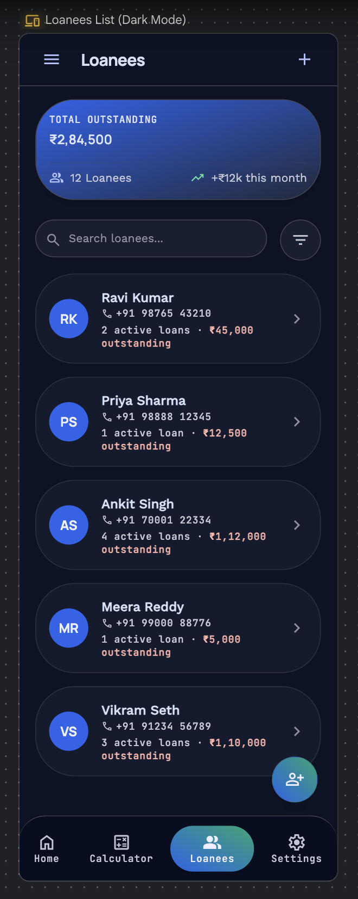
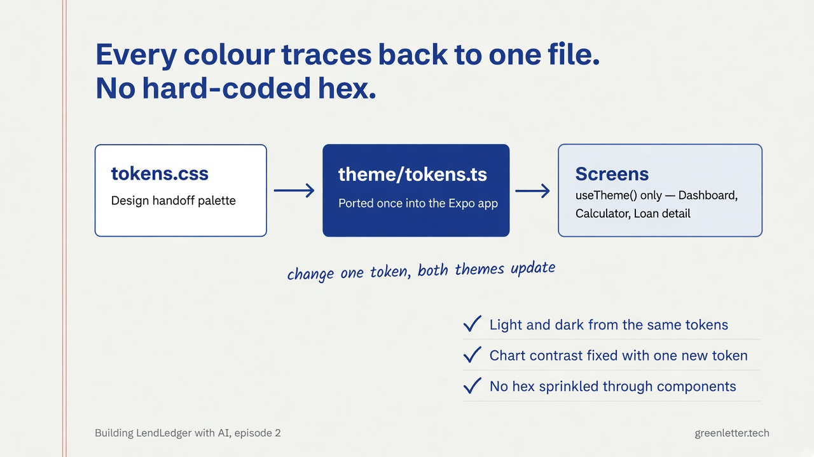

# Building LendLedger with AI, Episode 2: From AI-drawn screens to a design we could trust

*Series: how I built a real lending tracker, from a messy requirement to a shippable Android app (v1.2).*

**Read time:** ~6 minutes
**Episode:** 2 of 5

> **New to this series?** Start with [Episode 1: How I built a shippable Android app from a messy requirement](episode-01-the-brief.md) — the ₹100 → ₹3/day example and the offline cash-lending owner this whole app is built around. This episode assumes you've met both.

> This series is brought to you with [Green Letter Technologies (GLT)](https://greenletter.tech/?utm_source=medium&utm_medium=blog&utm_campaign=lendledger_ep2), a team that takes ideas from brief to shippable product, and [Neuron Workflows](https://goneuron.io/?utm_source=medium&utm_medium=blog&utm_campaign=lendledger_ep2), their no-code AI automation platform. More on both at the end.

---

Episode 1 ended with two things locked in place: the ₹100 → ₹3/day example, and an owner who collects cash offline and won't create an account. Neither of those comes with a screen attached. Before writing app code, we needed to know what LendLedger actually looked like — and getting there meant catching AI doing exactly what it's good at (generating options fast) right before it would have shipped us the wrong app.

## Round one: letting AI draw the app

The fastest way to see an app before building it is to describe it to an AI design tool. I used Google Stitch with a detailed prompt — screens, tone, palette, ₹ formatting — and in minutes had eight full screens: dashboard, calculator, loanee list, loan detail.

They looked like an app. That was the problem — they looked like *an* app, not *this* one. Rounded cards, a blue-to-green gradient, icons that could belong to any budgeting tool on the store. Nothing was wrong exactly, but nothing was earned either. AI had pattern-matched "lending app" against every lending app it had seen, not against an owner who collects ₹3 a day in cash, face to face.

We kept the palette — it was genuinely good — and dropped the assumption that "AI generated it" meant "AI decided it."

## Round two: an export that looked done and wasn't

Stitch could export the screens as a working Vite + React + Tailwind prototype. We took it. For about a day it felt like we'd skipped straight to a build.

Then we tried to actually change something — swap a card's spacing, adjust a status pill — and the seams showed. Utility classes stacked three deep per element, colors were hard-coded hex instead of a shared palette, and the component boundaries didn't match how a real React Native screen gets built. A `
` grid isn't a `FlatList`, and no amount of Tailwind fixes that gap.

**Decision: drop the generated prototype, hand-build the design system.**

Keeping it: nothing left to build, felt fast.
Dropping it: every follow-up change would have cost more than starting fresh — no shared tokens meant a palette tweak meant hunting through every screen, and the file structure didn't map to the Expo app we were about to ship.

It's archived, not deleted — `archive/stitch-prototype-v2/` — as a record of what "generated" looks like next to "designed," not as something to build on.

## What replaced it: one file, real tokens, both themes

The actual design reference for LendLedger is a single interactive HTML file with React loaded from a CDN — no build step. Serve it locally and you're looking at every screen, Light and Dark, phone and desktop frame, side by side.

The format isn't the point. The point is that every color in every screen traces back to one file, `tokens.css`. Card backgrounds, status colors, muted text on dark backgrounds — named tokens, not hex codes sprinkled through components. When the Expo app was built, those tokens were ported once into `theme/tokens.ts`, and every screen reads from `useTheme()` instead of hard-coding a color.

That discipline paid for itself fast. Weeks later, testers found the "expected" bars in the weekly chart were invisible in one theme — same gray as the background. The fix wasn't hunting down every chart component; it was adding one new token, `barTrack`, and pointing the chart at it. One line, one file, both themes fixed at once. That's the whole argument for tokens over hex: bugs become one-line fixes instead of scavenger hunts.

## The design artifact nobody screenshots: the written spec

The handoff showed what things looked like. It didn't say what "done" meant, what happens when a payment is late, or what a loanee record is allowed to contain. For that we wrote an actual product spec — versioned, dated, "approved for implementation" at the top, like a real team would write one.

This mattered specifically *because* AI was doing a lot of the building. A chat has no memory of a decision made three sessions ago. A written spec does. When a coding session needed to know whether extending a loan should touch already-paid days (no) or whether deleting a loanee with an active loan should be allowed (blocked), the answer wasn't "let me think about it again" — it was "see §8." The spec turned scattered decisions into a fixed contract, one both the human and the AI could be held to.

Two sections did the most work:

- **§2, success criteria** — a checklist of what a fresh install had to do, written *before* a single screen existed. (This became Episode 1's "Choice 3.")
- **§8, lifecycle rules** — the unglamorous but critical part: what "paid," "unpaid," and "partial" mean; that extending never silently recalculates the past; that closing with an outstanding balance warns but doesn't block.

Boring rules, written down early, are what kept a fast-moving AI-assisted build from quietly drifting.

## Takeaway

AI is fast at generating a design. It is not, on its own, a designer or a product owner. The Stitch screens gave us a usable palette in five minutes; turning that into *our* app took a hand-built token system and a written spec that no single AI session would have volunteered unprompted. Generated is a draft. Designed is a decision — and someone still has to make it.

---

## Series map

| Ep | Title | You'll leave knowing |
|----|-------|----------------------|
| 1 | The brief | Problem, user, local-first bet |
| **2** | **Spec & design** *(this post)* | Scope cuts, Stitch to real UI |
| 3 | Foundation | Monorepo, tested math, SQLite |
| 4 | Building the product | Loans, variance, bulk, refinance |
| 5 | Ship & polish to v1.2 | APK, crashes, dock, payment mode |

---

## From a messy brief to something real, with GLT

Design decisions like these — what to keep from an AI draft, what to throw out, what to write down instead of leaving to memory — are exactly what [Green Letter Technologies](https://greenletter.tech/?utm_source=medium&utm_medium=blog&utm_campaign=lendledger_ep2) works through with early-stage products every day, in their 2-week MVP sprint: strategy, rapid prototyping, user testing, a deployment-ready build. First conversation is a free 30-minute consult, no sales pitch.

If your "we need an app" moment is really "we need these steps to run on their own," look at [Neuron Workflows](https://goneuron.io/?utm_source=medium&utm_medium=blog&utm_campaign=lendledger_ep2) instead — describe a workflow in plain English or drag-and-drop it, then run, test, and publish.

Follow GLT on [LinkedIn](https://linkedin.com/company/green-letter-technologies) and [X](https://x.com/greenlettertech) for the next episode.

---

*Next: Episode 3 — Foundation: proving the math with tests before touching a screen, and the six things real testers broke in week one.*
