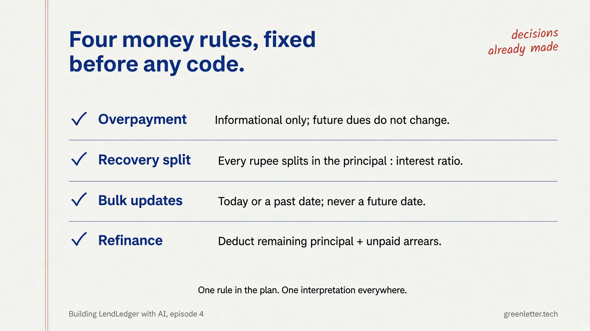
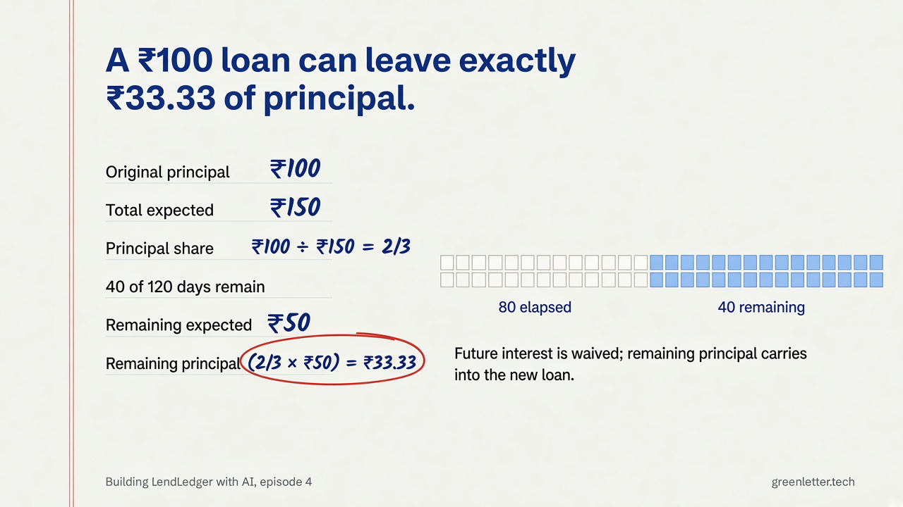
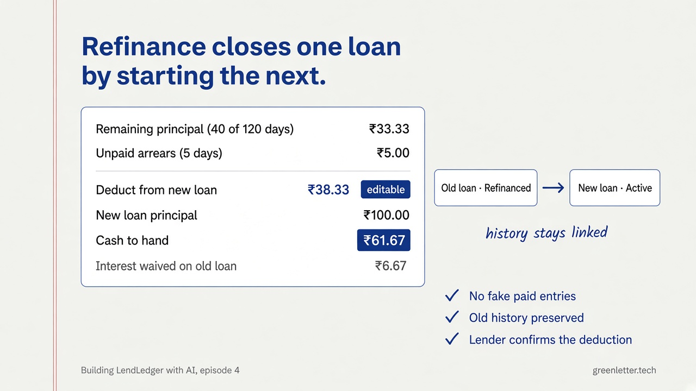

# Episode 4: The money logic that could not afford to be “almost right”

> **Publication-ready copy:** [`episode-04-medium.md`](episode-04-medium.md). This file retains the code-oriented source notes and embedded image references.

*Series: how I built a real lending tracker, from a messy requirement to a shippable Android app (v1.2).*

**Read time:** ~7 minutes
**Episode:** 4 of 5

> **New here?** [Episode 1](episode-01-the-brief.md): the brief and the north-star example. [Episode 3](episode-03-foundation.md): the tested foundation this episode builds on. This one is the hardest features in the app.

> This series is brought to you with [Green Letter Technologies (GLT)](https://greenletter.tech/?utm_source=medium&utm_medium=blog&utm_campaign=lendledger_ep4) and [Neuron Workflows](https://goneuron.io/?utm_source=medium&utm_medium=blog&utm_campaign=lendledger_ep4). More at the end.

---

MVP1 was feature-complete: 29 core tests, 39 mobile tests, six real fixes from the first week of use. Then real use kept going, and the requests stopped being about screens.

*"What if someone pays more than they owe?"*
*"I don't want to open thirty loans one at a time every evening — can I just do them all at once?"*
*"This loanee wants a new loan. Can we just roll the old balance into it?"*

Three different questions. One shared problem: all three are money math that has to be **exactly** right, not roughly right. This episode is about building all three — payment variance, bulk update, and refinance — the way you have to build anything where being 99% correct is the same as being wrong.

## Decision: write the rules down before writing a function

With several files changing at once and an AI collaborator moving fast across all of them, the risk isn't that any one line of code is wrong — it's that the *same rule* gets interpreted two different ways in two different files. So before any code, the plan for this stretch opened with a table titled, plainly, **"Decisions already made — do not re-open."** A sample:

| Question | Decision |
|---|---|
| Someone pays more than expected? | Informational only. Doesn't shorten the loan or reduce future dues — shown as a note, not applied. |
| A payment splits across principal and interest — how? | Proportionally, in the loan's original principal : interest ratio, every time. |
| Recording many loans' payments at once — what date? | Defaults to today. Backfilling a past day is allowed. Future dates are blocked. |
| Rolling an old loan into a new one — what gets deducted? | Remaining principal *plus* unpaid arrears, shown as a breakdown, editable by the lender before confirming. |



None of these are hard to code once decided. They're easy to get subtly wrong if every screen that touches money re-derives the rule from scratch. Writing them down once turned four ambiguous questions into four fixed answers everyone — human and AI — built against.

## The one number that had to be exactly right: ₹33.33

Refinance needed to answer: *of a loan's remaining term, how much of what's left is principal versus interest the lender never has to collect?* The rule is proportional: a loan's principal share of its total payments stays constant, so remaining principal is `principal-share × remaining expected payments`.

The test that had to pass before anything else did: a ₹100 loan over 120 days, 80 days already elapsed, nothing extended. Two-thirds of every payment is principal (₹100 of ₹150 total). Remaining expected payments across the last 40 days: ₹50. Two-thirds of that:

```
remaining principal = (100 / 150) × 50 = 33.33
```



That number went into the test suite before the refinance screen existed, the same discipline as Episode 3's calculator test. If ₹33.33 is ever wrong, every refinance conversation between an owner and a borrower is wrong — so it's the one thing in this feature that gets checked by a machine every single time, not eyeballed.

## Recording thirty payments without opening thirty screens

The bulk update screen exists because "mark today's collections" is an owner's most repeated action, and doing it one loan at a time doesn't match how they actually work — cash in hand, walking down a list.

The interesting constraint wasn't the math, it was the UI: a list that might hold 300+ rows, each with its own optional text input for a custom amount, that must **not** lose keyboard focus every time a checkbox above it toggles. The fix was mundane but easy to get wrong under pressure: keep each row's edit state in a map keyed by loan ID, not by its position in the list. Re-render the list all you want — a row's typing state is tied to *that loan*, not to *row seven*.

Submitting shows a one-line confirmation — how many marked paid, overpaid, underpaid, unpaid — before writing anything, and the write itself is one database transaction: either every change lands, or none do.

## Ending a loan by starting a new one

Refinance is the feature that most needed a name before it needed code. Close options considered and rejected:

- **Top-up** — wrong; a top-up adds money to a loan that's still running. This loan ends.
- **Restructure** — wrong; that's changing terms on the *same* loan, which is what Extend already does.
- **Renewal** — close, and kept as an acceptable button label if "Refinance" reads unfamiliar, but the underlying concept — a new loan whose proceeds settle an old one — is refinance.

The screen itself is a settlement breakdown, computed live, editable before confirming:

```
Remaining principal   (40 of 120 days)        ₹33.33
Unpaid arrears        (5 days)                ₹5.00
──────────────────────────────────────────────
Deduct from new loan   [ ₹38.33 ]  ← editable
Cash to hand to loanee                        ₹61.67
Interest waived on old loan                   ₹6.67   (muted)
```


**[SCREENSHOT NEEDED: `ep4-04-loan-detail-recovery.png` — exact capture instructions in `assets-needed.md`]**
**[SCREENSHOT NEEDED: `ep4-05-bulk-update.png` — exact capture instructions in `assets-needed.md`]**

If the new loan is smaller than what's owed, the app doesn't hide it — it shows "Loanee owes ₹x, collect before starting" and lets the lender proceed anyway. That's their call to make, not the app's to block.

The old loan doesn't disappear; it's marked `refinanced`, keeps its full history, and links forward to the new one. The new loan links back. Nothing is deleted, nothing is faked as "paid" — the old loan's remaining interest is explicitly recorded as *waived*, not silently erased.

## Staying honest about what wasn't checked

The plan for this stretch ends with a section most plans don't bother writing: **"Not done."** It says, plainly, that two planned review checkpoints — actually opening the app on a device or web preview to eyeball the new screens — didn't happen. Everything shipped was verified by code review and unit tests, not by human eyes on a running app.

That's not a flaw in the write-up. It's the point of writing it down: a plan that admits what it skipped is worth more than one that only ever looks finished on paper. It also became the literal to-do list for the smoke test pass that followed.

## Takeaway

Complex money features don't get safer because a human moves slower, and they don't get safer because AI moves faster. They get safer the same way every time: pin the ambiguous decisions in writing before any code touches them, write the one test for the number that must never be wrong, and write down — honestly — what still needs a real pair of eyes before you call it done.

---

## Series map

| Ep | Title | You'll leave knowing |
|----|-------|----------------------|
| 1 | The brief | Problem, user, local-first bet |
| 2 | Spec & design | Scope cuts, Stitch to real UI |
| 3 | Foundation | Monorepo, tested math, SQLite |
| **4** | **Building the product** *(this post)* | Loans, variance, bulk, refinance |
| 5 | Ship & polish to v1.2 | APK, crashes, dock, payment mode |

---

## From a messy brief to something real, with GLT

Pinning ambiguous rules before writing code — instead of after something breaks — is core to how [Green Letter Technologies](https://greenletter.tech/?utm_source=medium&utm_medium=blog&utm_campaign=lendledger_ep4) runs product builds: strategy workshop first, then rapid prototyping, then testing, then a deployment-ready MVP. Free 30-minute first conversation, no sales pitch.

If your "app" idea is really a workflow with clear rules, [Neuron Workflows](https://goneuron.io/?utm_source=medium&utm_medium=blog&utm_campaign=lendledger_ep4) lets you describe it in plain English or drag-and-drop it, then run, test, and publish — no app required.

Follow GLT on [LinkedIn](https://linkedin.com/company/green-letter-technologies) and [X](https://x.com/greenlettertech) for the last episode.

---

*Next: Episode 5 — Ship & polish to v1.2: a three-hour crash investigation, a working animated dock, and what "done" looks like on Android.*
